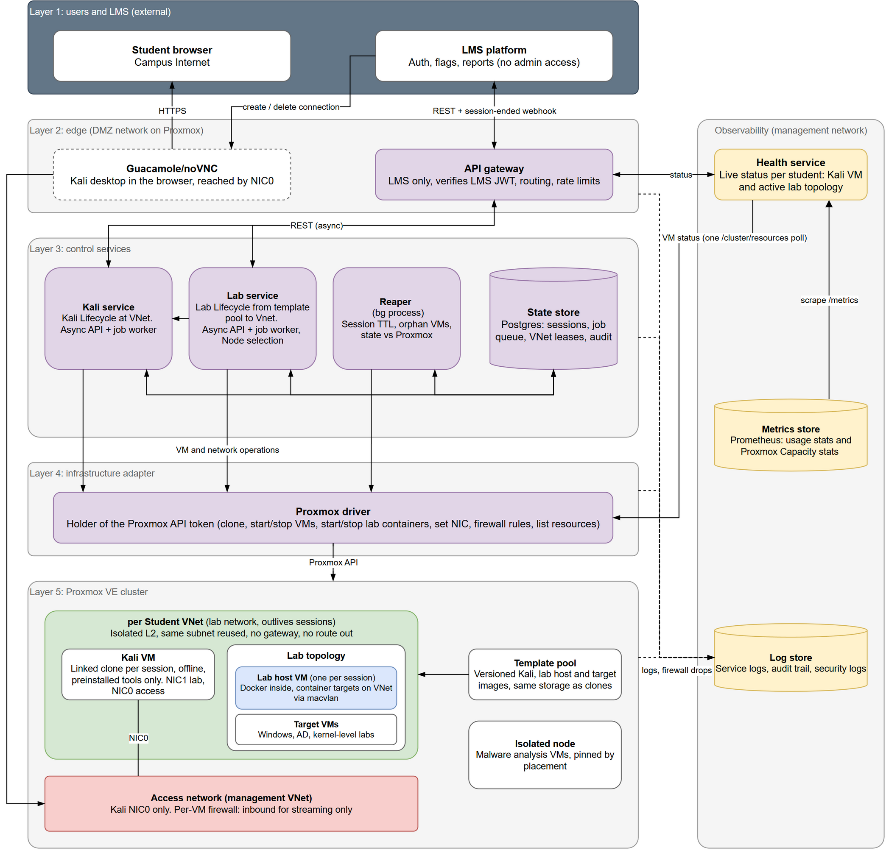

# Cybersecurity Lab Sandbox: Architecture

Source: `Architecture.drawio`. Exported 2026-10-21.

The sandbox creates and manages per-student lab environments on Proxmox and exposes them to the LMS through one API. It has five layers plus an observability column. Purple boxes are services this project builds; white boxes are external systems or Proxmox resources; yellow boxes are observability. The dashed box is owned by the LMS team but runs inside the sandbox's edge network. Green is the per-student VNet, red is the access network, and blue is the lab host VM.

The sandbox serves two modes, both offline:

- **Open world:** a Kali VM alone, with preinstalled tools, for free practice.
- **Tutorial:** a lab from the syllabus attached to the student's Kali.

## Layer 1: users and LMS (external)

Systems outside this project that use the sandbox.

| Component | Description |
|---|---|
| Student browser | Web browser on the student's device, connected through the campus network. Displays the LMS pages and the Kali desktop over HTTPS. No other software is installed on the student's device. |
| LMS platform | Learning management system, owned by the LMS team. Provides student login, lab pages, flag submission and reports. Sends all sandbox requests to the API gateway and creates or deletes remote desktop connections. Has no direct access to Proxmox. |

## Layer 2: edge (DMZ network on Proxmox)

Network zone that receives traffic from outside the sandbox.

| Component | Description |
|---|---|
| Remote desktop gateway (Guacamole or noVNC) | Owned by the LMS team. Converts the Kali desktop into a web page the browser can display. Connects only to the NIC0 interface of Kali VMs. |
| API gateway | HTTP entry point of the sandbox. Accepts requests from the LMS only, verifies the LMS-signed JWT on each request, applies rate limits, and forwards the request to the Kali service, the Lab service or the health service. |

Communication between the LMS and the gateway:

| Direction | Method | Purpose |
|---|---|---|
| LMS to sandbox | REST call | Start, stop or reset Kali; start or stop a lab; read job and session status. |
| Sandbox to LMS | Webhook | Report that a session ended by timeout or failure. |

## Layer 3: control services

Services that decide what to create, change or destroy. Start requests are asynchronous: the service returns a job id immediately, a job worker performs the operation, and the LMS reads the job status until it is finished.

| Component | Description |
|---|---|
| Kali service | Service that controls the Kali VM of each student: start, stop and reset. Owns the student's VNet: leases it to the student and records the lease in the state store. Before starting a VM it checks that the cluster has free capacity. Has its own async API and job worker. Used alone in open world mode. |
| Lab service | Service that controls the lab of each student: creates the lab's targets from the template pool inside the student's VNet and removes them when the lab ends. Selects the Proxmox node each target runs on. Has its own async API and job worker. Requires a running Kali VM and gets the student's VNet from the Kali service; the Kali service never calls the Lab service. Used in tutorial mode. |
| Reaper | Background process with no API. Destroys sessions that exceed their time limit, deletes VMs that belong to no session, and corrects records in the state store that do not match Proxmox. |
| State store | PostgreSQL database shared by the Kali service, the Lab service and the reaper. Stores sessions, the job queue, the VNet lease of each student, and the audit trail. |

## Layer 4: infrastructure adapter

Layer that translates service requests into Proxmox API calls.

| Component | Description |
|---|---|
| Proxmox driver | Service that executes operations on Proxmox for the control services and the health service. Operations: clone, start and stop VMs, start and stop lab containers, set network interfaces, set firewall rules, list resources. It is the only component that stores the Proxmox API token. |

## Layer 5: Proxmox VE cluster

Virtualisation platform that runs the student environments.

| Component | Description |
|---|---|
| Per-student VNet | Private layer 2 network, one per student. Connects the student's Kali VM to the student's lab targets. Has no gateway and no route to the internet, to other students or to the management network. All VNets use the same subnet. Exists permanently; the VMs in it exist only during a session. |
| Kali VM | Attacker machine used by the student. Linked clone of the Kali template, created at session start and destroyed at session end; no data is kept. Has no internet access and contains preinstalled tools only. NIC1 connects to the student VNet; NIC0 connects to the access network. |
| Lab topology | Set of targets for the active lab, defined by the lab's manifest, which marks each target as a VM or a container. Targets are created when the lab starts and destroyed when the lab ends. Consists of a lab host VM, target VMs, or both. |
| Lab host VM | VM that runs Docker and hosts the lab's container targets. One per session, created only when a lab with container targets starts (in parallel with the Kali VM) and kept until the session ends, so later labs reuse it. Containers are started through the QEMU guest agent, called by the Proxmox driver. Each container connects to the student VNet through macvlan and has its own IP and MAC address. |
| Target VMs | Lab targets that run as full VMs: Windows, Active Directory, labs that require their own kernel, and malware labs. |
| Access network | Management network that connects the remote desktop gateway to the NIC0 interface of every Kali VM. A firewall on each NIC0 allows inbound remote desktop traffic from the gateway only, drops all outbound traffic, rejects spoofed source addresses, and blocks traffic between Kali VMs. |
| Template pool | Set of versioned VM images: Kali, lab host and targets. Every VM is a linked clone of one of these images. A linked clone must be stored on the same storage as its template. |
| Isolated node | Separate Proxmox node that runs only malware analysis VMs. Keeps those VMs on different hardware from all other student VMs. |

## Observability (management network)

Components that record the state and activity of the sandbox. They run on the management network, which students cannot reach.

| Component | Description |
|---|---|
| Health service | Service that reports the current status of each student's Kali VM and active lab topology. Reads the status of all VMs from the Proxmox driver in one request, repeated at a fixed interval. The LMS reads the result through the API gateway. |
| Metrics store | Prometheus time-series database. Stores usage statistics (for example sessions running, peak users) and Proxmox capacity statistics (CPU, RAM, storage). Collects them by reading the health service's `/metrics` endpoint at a fixed interval; the health service gets the Proxmox figures from its poll of the Proxmox driver. |
| Log store | Central store for logs from Layers 2 to 5. Contains service logs (errors and events), the audit trail (which student started or stopped what, and when), and security logs (firewall drops, address spoofing, rejected API calls). |

Security events are attempts to leave the VNet, reach another student or the management network, spoof addresses, or misuse the API. Attacks on lab targets inside the student's own VNet are normal course activity and are not security events.

## Main flows

**Start a tutorial lab**

1. The student opens a lab in the LMS.
2. The LMS sends start requests to the gateway. The Kali service checks capacity, leases the student's VNet and queues a job for the Kali VM. The Lab service gets the VNet from the Kali service and queues a job for the lab's targets; if the lab has container targets, the lab host VM is created in parallel with the Kali VM.
3. The job workers call the Proxmox driver, which clones and starts the Kali VM and the targets on the student's VNet.
4. The LMS reads the job status until it is finished, receives the Kali connection details, and creates a remote desktop connection.
5. The student's browser displays the Kali desktop through the remote desktop gateway.

**Start open world**

Same as above without the Lab service: only the Kali VM is created.

**End of session**

1. The student logs out, or the reaper finds that the session exceeded its time limit.
2. The Proxmox driver destroys the Kali VM, the lab topology and the lab host VM. The VNet remains.
3. The sandbox notifies the LMS, and the LMS deletes the remote desktop connection.

## Ownership

| Owner | Components |
|---|---|
| LMS team | LMS platform, remote desktop gateway (Guacamole or noVNC) |
| This project | API gateway, Kali service, Lab service, reaper, state store, Proxmox driver, all Proxmox resources, observability |
